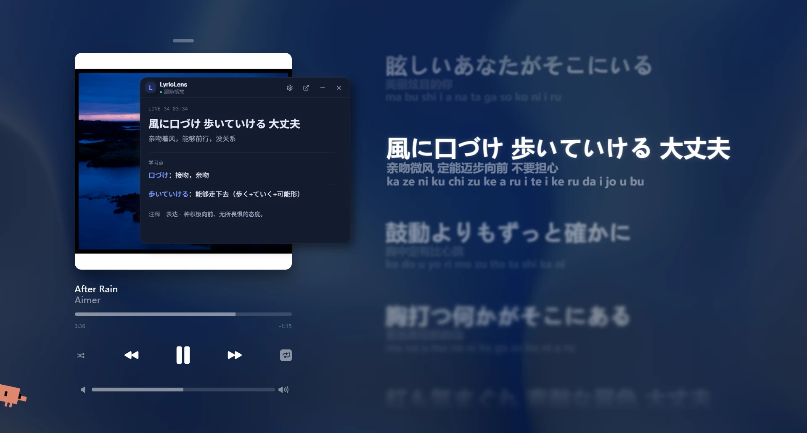

# LyricLens

[中文](README.md) · [English](README.en.md)

边听歌，边把歌词变成语言学习卡片。

LyricLens 有三个入口：网易云插件、独立桌面版、手机复习器，三个入口共用一本笔记本。这个仓库是其中的网易云插件，基于 BetterNCM，跑在网易云里面。它读取当前歌词，调用你配置的 OpenAI 兼容 Chat Completions 接口生成学习卡片，卡片跟着歌词一起滚动。

## 三个入口，一个产品

LyricLens v1.0 是一个产品、三个入口（host）。这个仓库是第 1 个入口，也就是 BetterNCM 插件：

| 入口 | 仓库 | 装在哪 | 干什么 |
|---|---|---|---|
| 插件（采集） | 你正在看的这个 | 网易云客户端 + BetterNCM | 播歌时读词、调 LLM 出学习卡片、加星收藏 |
| 桌面（采集） | [`lyriclens-desktop`](https://github.com/yoruuuchan/lyriclens-desktop) | 独立 Windows 应用 | 靠 SMTC + LRCLIB 独立运转，不依赖 BetterNCM |
| Review PWA（复习） | [`lyriclens-review`](https://github.com/yoruuuchan/lyriclens-review) · [直达](https://lyriclens-review.yoru-and-akari.dev) | 手机浏览器（可装桌面图标） | 把加过星的条目挪到手机上评级复习、Anki 导出 |

三个入口都是完整的产品，互不依赖。两个采集端哪个停更了，另一个照样独立运转；Review 端把学习进度装回口袋。

三个入口都支持 `NotebookEntry` JSON 导入和导出。桌面端和 Review PWA 还能配对一次，之后通过端到端加密接力同步笔记和复习进度，接力服务只存短时密文。插件端继续用 JSON 作为稳定的互通方式。

学习卡片默认叠加参考词典的弱标签：

- JLPT（N5–N1）
- CEFR-J（A1–C2）
- 中文外语考试大纲（高考 / CET-4 / CET-6 / 考研）
- IELTS / TOEFL 社区参考弱标签：v1.1 把这一档的颜色调得更淡，明确标出非官方

参考词典走单独的 CDN，和三个入口完全独立。

## 截图

<p align="center">
  
  
</p>

## 三分钟演示

不装网易云、不填 API Key，也能先用固定的样例数据把界面走一遍：

```powershell
start docs\demos\ui-demo-v2.html
```

demo 里可以切换中 / 日 / 英样例、播放状态和明暗主题，再打开设置看完整的配置项。

想走真实流程，就从 [v1.0.0 Release](https://github.com/yoruuuchan/LyricLens/releases/latest) 下载 `LyricLens.plugin`（文件名固定）。装好后放一首英文或日文歌，配好 OpenAI 兼容接口，就能验证整条链路：歌词捕获 → 学习卡片 → 加星入笔记本 → 导出 JSON。

## 安装

### 推荐：从插件官网下载

1. 退出网易云音乐。
2. 打开 [lyriclens.yoru-and-akari.dev](https://lyriclens.yoru-and-akari.dev)，点「下载最新版」，拿到 `LyricLens.plugin` 文件。
3. 把 `.plugin` 文件拖进 BetterNCM 的「插件管理」窗口，或者解压到 BetterNCM 插件目录下的 `plugins/lyriclens/`。
4. 重新打开网易云音乐，在 BetterNCM 插件管理里启用 LyricLens。

### 已经装过：插件内一键更新

打开 LyricLens 浮层，点齿轮按钮，切到「关于」页，点「立即更新」。下载、安装、提示重启都是自动的，全程不用离开网易云。

### 备选：从 GitHub Release

上面的渠道都用不了的话，去 [Releases](https://github.com/yoruuuchan/LyricLens/releases) 页面手动下载最新的 `LyricLens.plugin`，剩下的步骤和上面一样。

### 从源码安装（开发者）

1. 退出网易云音乐。
2. 把整个项目文件夹复制到 BetterNCM 插件目录，比如 `plugins/lyriclens/`。
3. 确认目录里有 `manifest.json`、`main.js`、`src/`、`styles/`。
4. 重新打开网易云音乐，在 BetterNCM 插件管理里启用 LyricLens。

不需要构建，源码直接就能加载。要重新打包 `.plugin` 的话，运行 `npm run build`。

## 配置

第一次放英文或日文歌、又还没配置 API 时，浮层会显示配置表单。你也可以点浮层右上角的齿轮按钮打开设置。

要填这些：

- API Endpoint：完整的 OpenAI 兼容 Chat Completions 地址，比如 `https://api.openai.com/v1/chat/completions`
- API Key：你的服务商密钥
- Model Name：模型名称
- 自动拆解：默认开启
- 浮层默认位置
- 浮层透明度

API Key 只写进本地的 BetterNCM 配置，同时在 localStorage 里同步一份，作为 MVP 阶段的降级存储。它不会上传到插件作者的服务器。

## 调试日志

插件会输出这些日志：

- 插件加载成功
- 当前 songId
- 歌词来源和字段探测
- 语言检测结果
- API 请求开始/成功/失败/超时
- PlayProgress 参数探测

怎么看：

- BetterNCM / 网易云客户端能用开发者工具时，打开 Console。
- 要打开主进程 Console，在 BetterNCM 环境里执行 `betterncm.app.showConsole(true)`。

### 诊断模式

诊断模式默认关闭。要在真实客户端里验证时，在 Console 执行：

```js
localStorage.setItem("ll_debug", "true");
location.reload();
```

关闭诊断模式：

```js
localStorage.removeItem("ll_debug");
location.reload();
```

打开后，Console 会用统一前缀 `[LyricLens:diagnostics]` 输出：

- BetterNCM / 网易云关键对象是否存在、类型、安全截断后的样例和错误
- `window.onProcessLyrics` 捕获到的歌词 payload 顶层结构
- 前 5 次以及之后每 10 秒一次的 `PlayProgress` 参数结构
- `styles/panel.css` 的解析、加载成功或失败状态

浮层里也会出现一个折叠的“诊断”入口，显示当前 `songId`、语言检测结果、歌词来源、卡片数、当前卡片 index、API 状态、最后一次错误和 CSS 状态。

## 已知限制

- BetterNCM / 网易云的歌词对象字段还要在真实客户端里继续确认。现在按这个顺序逐级探测、降级：`window.currentLyrics`、`window.CPPLYRICS_INTERNALS?.currentLyrics`、`window.AMLL?.currentLyrics`、`window.onProcessLyrics` wrapper、`betterncm.ncm.getPlayingSong()`。
- 没有 manifest hijack，也不主动改写网易云 / AMLL / CppLyrics 的内部渲染。
- 内存缓存只在这次客户端运行期间有效。
- MVP 阶段没有 BetterNCM 原生设置页，先用浮层里的齿轮表单。
- API 请求能不能用，取决于你配置的 endpoint、网络，以及 CORS / 客户端的 fetch 行为。

## 真实客户端验证记录模板

```md
### LyricLens v0.1 客户端验证记录

- 验证日期：
- 网易云音乐版本：
- BetterNCM/chromatic 版本：
- 操作系统：

#### Runtime Probe

- `window.betterncm`：
- `betterncm.ncm`：
- `betterncm.ncm.getPlaying`：
- `betterncm.ncm.getPlayingSong`：
- `legacyNativeCmder`：
- `window.currentLyrics`：
- `window.CPPLYRICS_INTERNALS?.currentLyrics`：
- `window.AMLL?.currentLyrics`：
- `betterncm.app.readConfig`：
- `betterncm.app.writeConfig`：

#### 返回样例

- `getPlaying` 安全截断样例：
- `getPlayingSong` 安全截断样例：
- 歌词 payload 顶层 keys：
- `lrc/yrc/tlyric/romalrc` 存在情况：
- lyric 字符串长度：
- 前 2 行脱敏/截断样例：
- `PlayProgress` 参数结构：
- `readConfig/writeConfig` 是否可用：
- CSS 加载方式是否可用：

#### 歌曲验证

- 英文歌 songId / 结果：
- 日文歌 songId / 结果：
- 中文歌 songId / 结果：
- API 失败结果：
- 切歌取消请求结果：

#### 已发现问题

-

#### 结论

-
```

## 本地测试

```powershell
npm test
```

测试覆盖语言检测、歌词预处理、缓存 key、LLM JSON 容错解析、播放时间同步、插件打包，以及跨入口的 `NotebookEntry` 对拍。

## License

LyricLens 使用 [GNU Affero General Public License v3.0 或更高版本](LICENSE) (AGPL-3.0-or-later) 协议发布。

简短说人话：
- 你可以自由使用、修改、分发本项目。
- 你 fork 出来的版本，以及任何**通过网络对外提供 LyricLens（或衍生）服务**的部署，都必须以同一 AGPL 协议开源。
- 选 AGPL 而不是 MIT/GPL 是有意的：本项目保留以后双授权（commercial license）的可能性。需要商业授权的话，请通过 Issues 联系。

字体等第三方资源的版权与许可见 [NOTICES.md](NOTICES.md)。

## 贡献

欢迎 PR。请在每个 commit message 末尾加上 `Signed-off-by: Your Name <your@email>`（用 `git commit -s` 会自动加），表示你同意按本项目的协议授权你的贡献（[Developer Certificate of Origin](https://developercertificate.org/)）。
